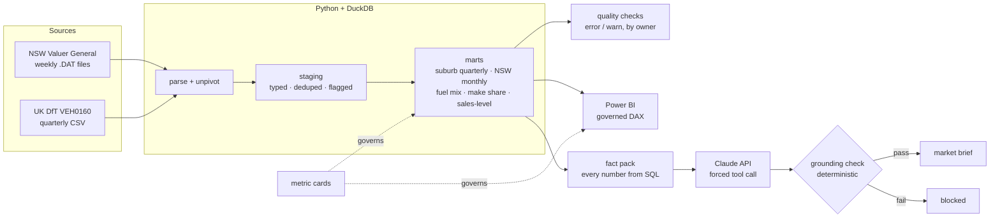

# Open Data Analytics with Claude

**NSW property sales + UK new-car registrations → governed DuckDB warehouse → Power BI measures →
a Claude-written market brief where every number is checked against the data.**

Built to show three things at once: analytics engineering on messy real public data, delivery and
governance discipline, and how to architect Claude Code and the Claude API so they're safe to trust
with numbers.

```bash
pip install -r requirements.txt
make check        # 37 tests · 11 data quality checks · 8 grounding eval cases — no downloads needed
make brief        # writes reports/insight_brief_sample.md
```

## What this demonstrates

| As a… | Look at |
|---|---|
| **Data analyst / analytics engineer** | Parsing a mixed-record-type government file (`parse_nsw.py`), unpivoting a wide CSV with suppressed cells, dedupe across weekly files, reporting-lag-aware YoY, flag-don't-drop staging that reconciles to the marts (`models/`, `quality/checks.yaml`) |
| **BI developer** | Sale-level fact so medians are right for any slice, DAX that matches SQL, YoY that blanks itself inside the reporting lag (`powerbi/`) |
| **Data governance** | Metric definition cards with owner, version and caveats, enforced by tests; licence terms enforced technically (`metrics/`, `tests/test_governance.py`, `docs/data-sources.md`) |
| **Project / delivery manager** | PRD, outcome-based delivery plan, RAID log, stakeholder updates generated from git history (`docs/pm/`) |
| **Claude architect** | CLAUDE.md, path-scoped rules, skills, subagents with least privilege, tested hooks, MCP, GitHub Actions, and a Claude API feature with structured output, prompt caching and evals (`.claude/`, `docs/claude-workflow.md`) |

## Architecture



## The Claude design in one paragraph

Facts Claude can't infer live in a 30-line `CLAUDE.md`; SQL conventions load only when SQL is open
(`.claude/rules/`). Repeatable procedures are skills (`/new-metric` keeps card, SQL, check and DAX in
step; `/dq-audit` runs in a forked read-only subagent). Reviews go to subagents with narrow tools.
Anything that must never break — touching licensed raw data, finishing with failing checks, a
read-only agent writing — is a hook or permission, and the hooks have their own tests. In the
product itself, **SQL computes every number and Claude only writes the words**: it must cite a fact
id for each sentence, and a deterministic checker rejects any number that doesn't match a cited fact.
Full map: [`docs/claude-workflow.md`](docs/claude-workflow.md).

### The guardrails earned their keep during the build
- The grounding evals caught a real bug: a ±0.05 percentage tolerance let "26.99%" match an
  unrelated fact worth 27.0. Matching is now precision-aware ([ADR-0002](docs/adr/0002-claude-writes-words-not-numbers.md)).
- The hook tests caught the sample-data edit guard missing relative paths ([ADR-0003](docs/adr/0003-guardrails-in-hooks-not-prompts.md)).

## Run on real data

**macOS / Linux**
```bash
make fetch                         # NSW 2024–25 yearly + 2026 weekly files + DfT VEH0160 into data/raw/
DATA_MODE=real make check
DATA_MODE=real make brief          # uses Claude if ANTHROPIC_API_KEY is set
python evals/run_evals.py --live 20  # how often the live model writes a fully grounded brief
```

**Windows (PowerShell, no `make` needed)**
```powershell
python -m pip install -r requirements.txt
powershell -ExecutionPolicy Bypass -File scripts\run_real.ps1 -Fetch
```

**If an NSW download fails:** the Valuer General has moved its site before. Download the yearly and
weekly zips from the [property sales portal](https://valuation.property.nsw.gov.au/embed/propertySalesInformation)
into `data/raw/nsw_downloads/`, then run `python -m oda.fetch --nsw-local --dft` (or the script
again). The DfT file's address changes each release; if it fails, copy the current
`df_VEH0160_UK.csv` link from the [DfT data files page](https://www.gov.uk/government/statistical-data-sets/vehicle-licensing-statistics-data-files)
into `DFT_VEH0160_URL`.

Then in Claude Code: `/dq-audit` to explain any warnings, `/insight-brief` for the narrative.

## Status

Built and fully tested on sample data. The first real-data run (2024–2026 NSW sales and the latest
DfT release) and a live-model baseline for the brief are next — see
[`docs/pm/delivery-plan.md`](docs/pm/delivery-plan.md) (milestones M4–M5). Real results will be added
here, with every number taken straight from the pipeline's own outputs.

## Repo map

```
.claude/            settings (permissions + hooks), hooks/, rules/, skills/, agents/
.github/workflows/  ci.yml · claude.yml (@claude) · claude-sql-review.yml (auto review)
.mcp.json           read-only DuckDB MCP server for ad-hoc questions
src/oda/            fetch · parse_nsw · samples · pipeline · quality · insights
models/             staging/ 01–02 · marts/ 10–21  (run in filename order)
quality/            checks.yaml
metrics/            governed KPI cards + _template.yaml
powerbi/            measures.dax + setup notes
evals/              grounding checker cases + live model eval
docs/               data-sources · claude-workflow · adr/ · pm/ (PRD, plan, RAID, updates)
data/sample/        SYNTHETIC files in the real layouts (committed); data/raw/ is gitignored
```

## Data and licences
- **NSW property sales** — NSW Valuer General, CC BY-NC-ND 4.0 for non-commercial use; commercial use
  needs a PSI licence. Raw and derived files never leave your machine.
- **UK new-car registrations** — Department for Transport, Open Government Licence v3.0.
- **`data/sample/`** — synthetic. Numbers in sample outputs mean nothing; they prove the mechanics.

Details: [`docs/data-sources.md`](docs/data-sources.md).

---
Built by Nilay Tekale with Claude Code. [LinkedIn](https://www.linkedin.com/in/nilay-tekale-84220584)
